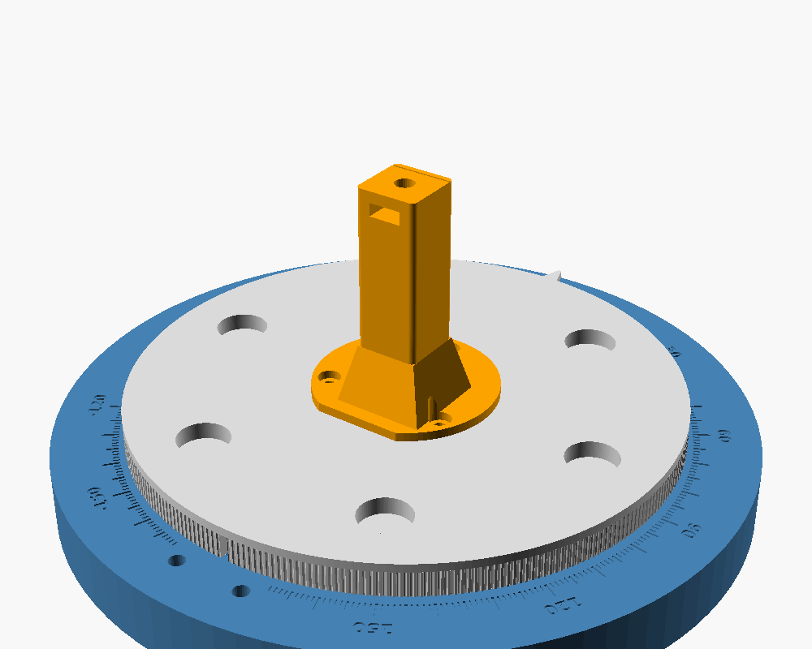
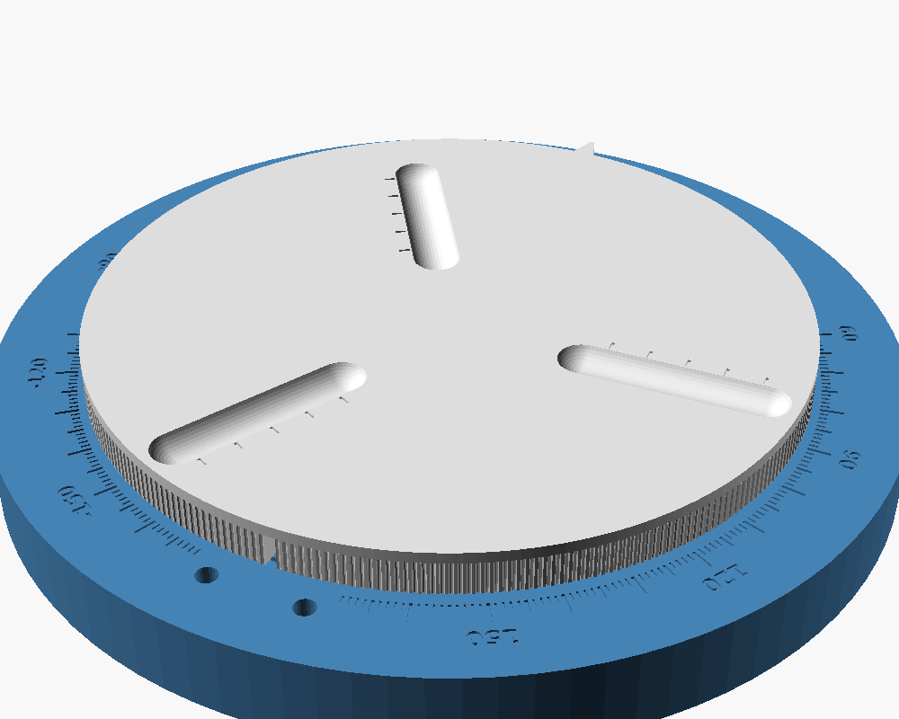

# Rotating stand (low-assembly)

A simpler version of [`../stand`](../stand): **5 printed parts and 6 screws,
about 5 minutes to assemble.** It has no bearings, BBs, spring plunger or
ballast. The platter turns plastic-on-plastic on a raised ring, and a printed
spring leaf clicks into a groove every 5°.





It keeps everything else from the original stand:

- the array phase center on the rotation axis;
- the engraved ±180° scale and pointer;
- the 300-tooth GT2 rim and rear insert holes, so a stepper can be added
  later.

## Two ways to hold the Phaser

| Top | Print | Hardware | Notes |
|---|---|---|---|
| **Tripod** (`stl/tripod/`) | `stl/common/` + `stl/tripod/` | 1 screw | The kit's tabletop tripod stands in three grooves. No mast to print |
| **Mast** (`stl/mast/`) | `stl/common/` + `stl/mast/` | 6 pieces | Stiffer and lower; no ball joint in the load path |

### Tripod top

The tripod platter has three ball-end grooves, 4 mm deep and about 12.6 mm
wide, for the kit tripod's 11 mm rubber feet.

- **Alignment:** the grooves meet at the thread position, not the platter
  center. With the ball head pointing straight up, the array center sits on
  the rotation axis, just as with the mast.
- **Leg length:** the grooves run from short legs out to full extension,
  where the feet are 5.5 in (139.7 mm) apart. Ticks every 10 mm help you put
  all three feet at the same radius, which keeps the tripod centered.
- **Leg orientation:** the legs are rotated 60° away from the offset
  direction, so no groove end runs into the rim.
- **Setup:**
  1. Lock the ball head pointing straight up.
  2. Set the feet in the grooves.
  3. Turn the Phaser on the stud until the patch face lines up with the
     pointer.

## Parts

**Print everything in `stl/common/`, plus *one* of `stl/tripod/` or
`stl/mast/`.** Never both: the two platters have different tops.

| STL | Print | Notes |
|---|---|---|
| `common/base.stl` | as-is | 240 mm Ø. 3 walls, 25% infill. More infill means more weight, which means less tip |
| `common/retainer.stl` | countersink down | |
| `tripod/platter_tripod.stl` | **upside down**, so the post and skirt point up | 191 mm Ø, with foot grooves. 0.12–0.16 mm layers keep the GT2 teeth crisp |
| `mast/platter.stl` | **upside down**, so the post and skirt point up | 191 mm Ø, with the mast pocket |
| `mast/mast.stl` | foot down | 5 walls, 40% infill. It carries the Phaser |
| `mast/lock_wheel.stl` | nut pocket up | |

No supports. **Use PETG if you can:** the detent leaf flexes on every click,
and PLA fatigues sooner. PLA still works, but expect to reprint a base
eventually.

## Hardware

| Item | Qty | Build | Where |
|---|---|---|---|
| M4 × 16 countersunk (flat-head) screw | 1 | both | retainer → platter post |
| M4 × 12 screw | 3 | mast | mast → platter |
| 1/4-20 × 3/4" hex bolt | 1 | mast | stud the Phaser threads onto |
| 1/4-20 hex nut | 1 | mast | pressed into the lock wheel |

The tripod build needs only the M4 screw. An M5 does not fit the printed
pilot hole in the platter post; use M4.

The screws cut their own threads in the printed pilot holes, so no inserts
or tapping are needed. Optional extras: 12 mm stick-on feet, which have
recesses on the base underside, and a little dry PTFE lube on the ring.

## Assembly (mast build)

For the tripod build, do steps 2–3, then follow "Tripod top" above.

1. Press the 1/4-20 nut into the lock wheel.
2. Lower the platter onto the base so the post drops through the center hole
   and the skirt drops into the channel.
3. Flip the stand over. Put the retainer on the post and drive the M4 screw
   in until it's snug, then back it off about a quarter turn so the platter
   spins freely.
4. Slide the 1/4-20 bolt head into the slot at the back of the mast top, then
   fix the mast into the platter pocket with the three M4 screws. The flat
   side of the foot sets its orientation.
5. Thread on the lock wheel, then the Phaser block. Square the board to the
   line engraved on the mast pad, and spin the wheel up to lock it.

## Things to check on the first unit

- **Fit:** the post should turn freely in the base with no wobble. If it
  binds or rattles, change `bore_fit` (radial clearance, default 0.5 mm) and
  reprint the base only. The first test print, at 0.3 mm, needed the bore
  opened by hand.
- **Detent feel:** if the clicks are too stiff or too soft, change
  `leaf_preload` (default 0.5 mm) and reprint the base. The first test
  print's leaf (1.6 mm thick, 0.8 mm preload) was too stiff to turn. The
  current one is 1.2 mm thick and about twice as tall, and is roughly 20×
  softer.
- **Scale:** ticks are every 5°, 1 mm wide and 0.8 mm deep. The 1° ticks were
  dropped because they were too fine to print cleanly.
- **Array offset:** `array_center_from_left` is still an assumption (see
  `../stand/README.md`). `mast/mast.stl` and `tripod/platter_tripod.stl` depend on it.
- **Wiring:** route the cables with slack. There is no end stop, so stay
  within about ±180°.

## Re-exporting

```
cd hardware/stand-simple
openscad -D 'part="base"'           -o stl/common/base.stl            phaser_stand_simple.scad
openscad -D 'part="retainer"'       -o stl/common/retainer.stl        phaser_stand_simple.scad
openscad -D 'part="platter_tripod"' -o stl/tripod/platter_tripod.stl  phaser_stand_simple.scad
openscad -D 'part="platter"'        -o stl/mast/platter.stl           phaser_stand_simple.scad
openscad -D 'part="mast"'           -o stl/mast/mast.stl              phaser_stand_simple.scad
openscad -D 'part="lock_wheel"'     -o stl/mast/lock_wheel.stl        phaser_stand_simple.scad
```
